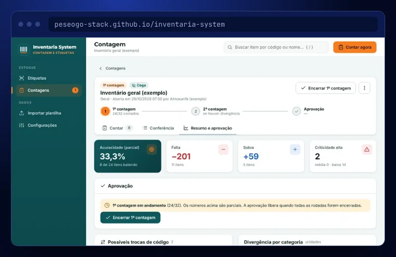
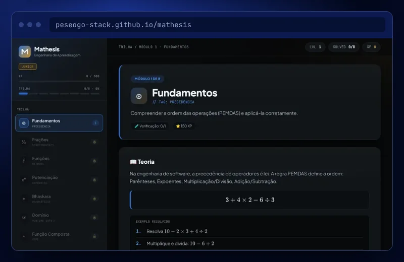
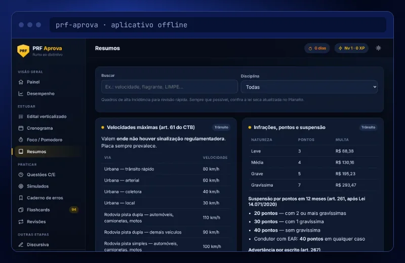
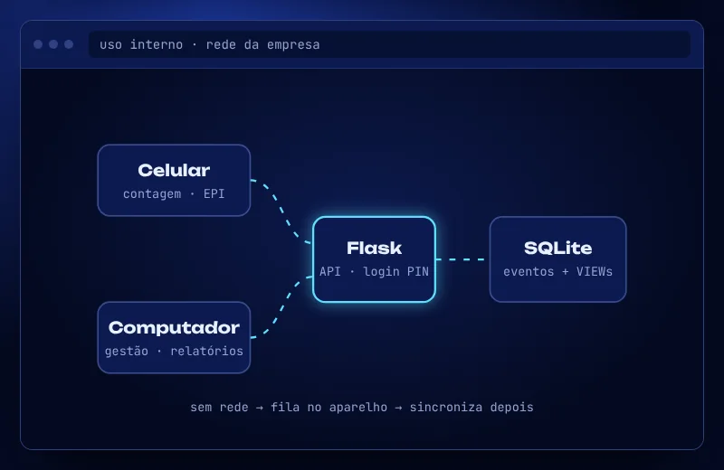

  

  
  
  

## Do poste ao código

Sou o Pedro, estudante de **Engenharia de Software na UNINTER** e atuo em **TI e Telecomunicações na Âmbar Energia** em Boa Vista (RR), com base técnica como eletricista de distribuição.

No campo aprendi a seguir procedimento à risca (NR-10, NR-35), levar segurança a sério e resolver o problema com o cliente esperando. Levo o mesmo método para o código: entender o problema de perto, seguir um passo a passo e testar antes de entregar. No longo prazo, quero construir **software para energia e automação industrial**.

## O que eu construí

<table>
  <tr>
    <td width="50%" valign="top">
      
      <h3>C1 · Inventaria System</h3>
      
Inventário de almoxarifado sem papel: importa a planilha do Excel, conta pelo celular com código de barras e recontagem só do que divergiu.

      
<a href="https://peseogo-stack.github.io/inventaria-system/"><b>Abrir demo</b></a> · <a href="https://github.com/Peseogo-stack/inventaria-system">Código</a>

    </td>
    <td width="50%" valign="top">
      
      <h3>C2 · Mathesis</h3>
      
Trilha gamificada de matemática básica, com pré-requisitos, revisão espaçada e analogias de programação.

      
<a href="https://peseogo-stack.github.io/mathesis/"><b>Abrir demo</b></a> · <a href="https://github.com/Peseogo-stack/mathesis">Código</a>

    </td>
  </tr>
  <tr>
    <td width="50%" valign="top">
      
      <h3>C3 · PRF Aprova</h3>
      
Plataforma de estudos para o concurso da PRF que funciona offline: questões estilo Cebraspe, simulados e flashcards com repetição espaçada.

      
🔒 Código privado

    </td>
    <td width="50%" valign="top">
      
      <h3>C4 · Sistema de almoxarifado</h3>
      
Requisições das equipes de campo, controle de EPI e painel de indicadores, com back-end em Python (Flask) e SQLite.

      
🔒 Uso interno

    </td>
  </tr>
</table>

<a href="https://peseogo-stack.github.io/#projetos"><b>Ver todos os detalhes no portfólio →</b></a>

## Com o que eu trabalho

**Em uso nos projetos**

**Estudando agora:** JavaScript · Python e SQL · redes e fibra óptica · inglês todos os dias

**Da área elétrica e telecom:** fibra óptica · NR-10 · NR-35 · SEP · redes de distribuição

## Agora

- TI e Telecomunicações na Âmbar Energia
- 2º período de Engenharia de Software (UNINTER)
- Redes de Computadores (MEC) e Servidores de Redes (SENAI)

English version

 

Hi! I'm Pedro, a Software Engineering student at UNINTER working in **IT and Telecommunications at Âmbar Energia** in Boa Vista, Brazil, with a technical background as a power distribution electrician.

Field work taught me to follow procedures carefully, take safety seriously and solve problems under pressure. I bring the same method to code. In the long run, I want to build software for the energy and industrial automation sectors.

**Portfolio:** https://peseogo-stack.github.io

